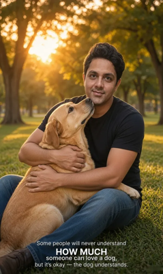

## Hi, I'm Sunny Raghvendra Singh

Independent researcher in **India**.

I study how far **LLM coding can be trusted against human judgement**, and I build pipelines that pull structured data out of online text and public documents.

It started with Cooper: I wanted to know what owners of diabetic dogs actually do and ask, so I built the tools to find out.

> [!NOTE]
> **📄 Paper**
> [Speaker-level care-practice attribution in canine-diabetes discussions: a preregistered single-annotator evaluation of a language model](https://doi.org/10.5281/zenodo.24439010)
> Preprint · preregistered at [OSF j4za5](https://osf.io/j4za5/)

> [!TIP]
> **🤝 Open to**
> - Annotation swaps and second-coder help
> - Preprint review
> - Open research projects on LLM evaluation and health data

> [!IMPORTANT]
> **🛠️ How I work**
> I build reproducible crawling and LLM extraction pipelines with AI coding agents, with exact-quote checks on every model output. Most code is private. Ask if you'd like to see something.

 
<b>Cooper</b>, my Labrador, and the reason I started this work.
  

